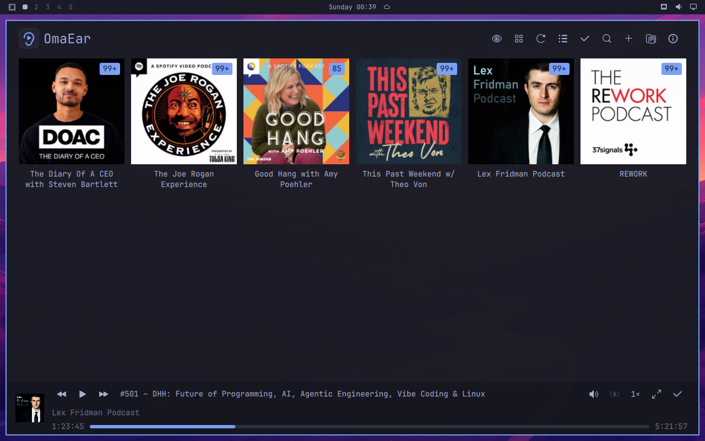
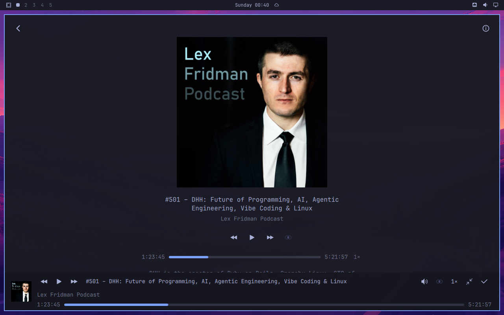

<p align="center"></p>

OmaEar is a podcast player for [Omarchy](https://omarchy.org). It keeps a shelf of your shows and keeps playing after you close the window.

Designed together by [Allan Dehn](https://github.com/allandehn) and [Grok](https://x.ai).





## Install

On Omarchy, run:

```
curl -fsSL https://raw.githubusercontent.com/allandehn/omaear/main/install.sh | bash
```

It adds the OmaEar package repository, with packages signed by Allan Dehn (key `AC6F F13C 76D8 916C CCF2  DA05 C322 5162 B525 7DB4`), and installs the app. Updates then arrive with `omarchy update`. Open **OmaEar** from the app launcher, or run `omaear`.

Prefer to do it by hand? Read [install.sh](install.sh). It's a handful of lines.

## Getting started

Paste a feed URL with **Add feed**, find shows with **Find new podcasts**, or bring your whole library over from another podcast app with **Import OPML**. All three live in the shelf's **⋯** menu, next to **Export OPML…**, which saves your shows as an OPML file for another app or a backup.

## Features

**Shelf.** Your shows as a gallery or a list. Shows with unheard episodes sit in front, newest first, with an unheard count on the cover. Caught-up shows sit behind, dimmed. The eye button switches between all shows and unplayed only; gallery or list is in the ⋯ menu. The top bar keeps just the eye, Refresh and Queue, and the ⋯ menu holds the rest.

**Search.** Ctrl+F (or Search episodes in the ⋯ menu) searches show names, episode titles and show notes across everything you subscribe to, with results updating as you type. Show matches come first, then titles, then notes, newest first within each. The Show, Title and Notes chips (Alt+1/2/3) pick what to search. The globe button sends the same words to Find new podcasts.

**Find new podcasts.** Search the podcast directory or browse the top charts for any region (the flag picks it, and the choice is remembered). Preview a show before you subscribe. Click a publisher name to see all of that publisher's shows, newest first.

**Episodes.** Play straight from the episode art. Open an episode for its full notes, where links open in your browser and timestamps jump the player to that point.

**Queue.** Add episodes, play next, drag to reorder. An episode stays in the queue while it plays and leaves once it's finished or marked played. Queued episodes carry a small queue mark on their art, and their details page shows their place ("In queue, #2 of 5"). Previous and next in the player bar and on Now Playing step through the queue by hand (next names the episode on hover; when the playing episode isn't queued, next goes to queue #1). **Autoplay** only decides what happens when an episode ends: on, the queue plays on; off, playback stops. Toggle it with the autoplay button (a list with a play mark) in the player bar, on Now Playing or on the Queue page.

**Player.** Previous and next in the queue (previous works when the playing episode is queued at #2 or later and leaves it where it was, progress kept), back 15 s, forward 30 s, a scrubber that shows the time on hover, speeds 0.75×, 1×, 1.25×, 1.5×, 1.75× and 2×, volume (click to mute, hover for the slider, scroll to adjust in 5% steps), speed (click to step through, hover for the list, scroll to move through it), and a **Mono / Stereo** toggle for recordings with lopsided channels. Now Playing gives you a large cover you can resize with Ctrl+wheel, the transport buttons, and volume, speed, autoplay and mono below them with the same popups as the player bar.

**Status.** Refresh progress ("Updating 3 of 16 feeds: …") and short messages such as "Added to queue." show in a small pill just above the player bar, so nothing on the page moves.

**Keyboard.** Every page works from the keyboard: arrows and Tab move a quiet focus ring through the buttons, podcasts, episodes and player bar, Enter opens or presses, the Menu key opens the right-click menu, and Back returns the ring to where you came from.

**Keeps playing.** Close the window and the episode carries on, with controls in the Omarchy bar and media keys. Open OmaEar again and the same window comes back.

**Fits your theme.** Colors and fonts come from the current Omarchy theme and change live when you switch themes, logo included. Text size follows your display scale.

**Info.** Info in the ⋯ menu (or `?`) is a short page of the shortcuts and hidden tricks the tooltips don't cover (keys, search, artwork sizing), shows the version, and tells you when an update is available (a small dot on ⋯ says so too). Click "run omarchy update" and it does just that.

## Shortcuts

| Key / mouse | Action |
| --- | --- |
| Space | Play / pause |
| Arrows | Move through buttons, podcasts, episodes and the player bar; Enter opens or presses |
| Tab / Shift+Tab | Jump between areas (top bar, list, player bar) |
| Menu / Shift+F10 | Right-click menu for the highlighted item |
| Delete (queue) | Remove the highlighted episode from the queue |
| Ctrl+F | Search your episodes (Enter opens the top result) |
| Esc, Alt+Left, Backspace, mouse Back | Back |
| Alt+Right, mouse Forward | Forward |
| Ctrl+wheel, Ctrl+= / Ctrl+− | Resize covers and art |
| Ctrl+0 | Reset art to its default size |
| ? | Info |
| Ctrl+Q | Close the window (audio keeps playing) |

## Marking played

Right-click an episode (its row or its art) to play it now or next, mark it played or unplayed, mark everything older or newer, queue it, or mark the whole show. The cover in the player bar has the same menu with Pause or Resume at the top, and without play next or older/newer. Right-click a show on the shelf to mark all of it played. Right-click a cover or empty shelf space for **Unsubscribe from all**, which asks twice before it removes every show. On episode details and Now Playing, right-click the art to mark the episode played. An episode counts as heard in its last few percent, so a closing jingle doesn't keep a show in front. Playing an episode you've already heard marks it unplayed again.

Menus and the volume and speed popups close when you click elsewhere, and that click still does its job: Back goes back, and a right-click opens the next menu straight away. They also close when the page or layout changes.

## Your data

The library lives in `~/.local/share/omaear/` and downloaded audio and artwork in `~/.cache/omaear/`.

## Uninstall

Press Del on OmaEar in the app menu, or run:

```sh
sudo pacman -Rns omaear
```

That removes the app but keeps your shows, progress, and settings, so a reinstall picks up where you left off. To remove those too:

```sh
rm -rf ~/.local/share/omaear ~/.cache/omaear ~/.config/omaear.conf
```

To also remove the OmaEar package source, delete the `[omaear]` section from `/etc/pacman.conf` and run `sudo pacman-key --delete AC6FF13C76D8916CCCF2DA05C3225162B5257DB4`.

## Build from source

Needs Qt 6 (Quick, Quick Controls, Multimedia, SQL, Network, D-Bus), all already on Omarchy.

```
qmake6
make -j
./omaear --self-test
make install    # installs to ~/.local, no root needed
```

To build the Arch package yourself, use `packaging/PKGBUILD`, or run `packaging/build-local.sh` to build one from this checkout.

Releases are made with `scripts/release.sh X.Y.Z` (try `--dry-run` first); see `AGENTS.md`.

## License

[MIT](LICENSE)
